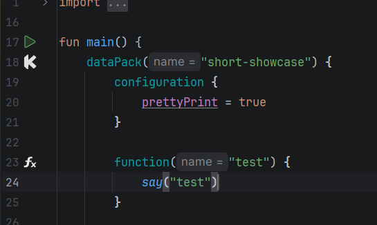
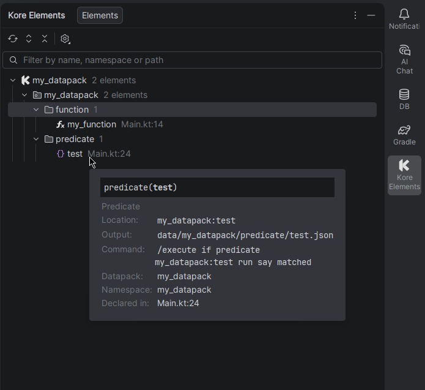

# Kore Assistant

An IntelliJ IDEA extension providing powerful tools for working with [Kore](https://kore.ayfri.com), a Kotlin library
for creating Minecraft datapacks without writing JSON.

<!-- Plugin description -->

An IntelliJ IDEA extension providing powerful tools for working with [Kore](https://kore.ayfri.com), a Kotlin library
for creating Minecraft datapacks without writing JSON. Features:

- `function("name")` strings are real references: Ctrl+Click to the declaration, Find Usages and Rename from either side,
  and a gutter icon on each function listing its calls.
- Completion of your function names in `function("...")` and of vanilla ids in `item("...")`, `block("...")` and
  `XxxArgument("...")`, taken from the Kore version your project uses.
- A "Kore Elements" tool window listing every kind of Kore declaration as a tree mirroring your generated datapack, with
  hover previews, copy actions and jump-to-source, plus inlay hints showing where each declaration is generated and a
  gutter icon on every declaration with the same hover.
- Inspections catching what compiles but breaks in-game: `function("name")` calls to a function declared nowhere (with
  quick-fixes), two declarations writing the same file, invalid `craftingShaped` patterns, unknown vanilla ids,
  `Items.X.components = ...` changing a shared enum entry, `^` coordinates mixed with `~`, and invalid macro names.
- Run integration through the [Kore Gradle plugin](https://kore.ayfri.com/docs/guides/gradle-plugin): a run marker on
  `dataPack(...)` for `koreRun` / `koreBuild` / `koreLink` / `koreReload`, an intention that applies the plugin to your
  `build.gradle.kts`, completion of your world names in `kore { worlds = ... }`, and links from the run console back to
  your declarations.
- Live templates for datapacks, functions, loot tables, advancements, recipes and more, and a New > Kore DataPack file.

<!-- Plugin description end -->

---

**Kore Assistant** enhances your development experience with Kore by providing useful features directly within IntelliJ
IDEA.

## Features

* **Gutter Icons:** Every Kore declaration (datapacks, functions, advancements, loot tables, recipes, tags...) has an
  icon in the editor gutter; hovering it shows the same card as the tool window. The function icon lists every
  `function("name")` call to that function.
* **Function references:** <kbd>Ctrl+Click</kbd> on the string of a `function("name")` command jumps to the declaration,
  including `function("namespace:name")`, `function("namespace", "name")` and names with a directory (`"utils/helper"`).
  Find Usages and Rename work from the call or from the declaration; renaming keeps namespaces and directories.
* **Completion:** inside `function("...")`, the functions your project declares; inside `item("...")`, `block("...")`
  and any `XxxArgument("...")`, the vanilla ids of the Kore version your project depends on.
* **Inlay Hints:** each declaration shows its resource location (`pack:utils/helper`) after its arguments, or its output
  file path, configurable in <kbd>Settings</kbd> > <kbd>Editor</kbd> > <kbd>Inlay Hints</kbd>.
* **Kore Elements Tool Window:** Browse every kind of Kore declaration (advancements, loot tables, recipes, predicates,
  dialogs, worldgen, and more) as a tree mirroring the generated datapack layout, groupable by output structure, source
  file or flat list, and sortable by name, kind, namespace or declaration order. Filter and speed search narrow the tree
  down; hovering a row shows a documentation-style card with its resource location, generated path, command and source;
  right-clicking offers Copy, Jump to Source and Find Usages.
* **Inspections:** a `function("name")` command whose target is declared nowhere in the project is an error, with
  quick-fixes to pick the closest name, call it under the namespace it actually lives in, swap `(name, namespace)`
  arguments passed in the wrong order, or create the function. Two declarations writing the same file in one datapack
  are a warning (the last one generated silently wins). A `craftingShaped` recipe with more than 3 rows, rows of
  different widths, a pattern character without a `key`, or an unused key is an error. An unknown vanilla id such as
  `item("diamond_swrod")` is a warning with the closest ids as fixes. Assigning `Items.DIAMOND_SWORD.components`
  (which changes the entry for the whole datapack), mixing local `^` coordinates with `~` or absolute ones, and macro
  names holding anything else than letters, digits and underscores are errors.
* **Run integration:** with the [Kore Gradle plugin](https://kore.ayfri.com/docs/guides/gradle-plugin) applied, the run
  marker on `dataPack(...)` offers `koreRun` (build, link into your worlds, `/reload` over RCON), `koreBuild`, `koreLink`
  and `koreReload`, each as a Gradle run configuration. Without it, <kbd>Alt+Enter</kbd> on `dataPack(...)` offers
  **Apply the Kore Gradle plugin**, which shows the `build.gradle.kts` diff (plugin line + `kore { mainClass }` block)
  before writing it and syncing. Inside `kore { worlds = listOf("...") }`, completion lists the worlds of your Minecraft
  installation. Resource locations Kore prints in the run console link back to their declaration.
* **Live Templates:** `dp`, `dpmain`, `fn`, `load`, `tick`, `exec`, `lt`, `adv`, `shaped` and `ftag` scaffold the common
  Kore blocks and import the builders they use. <kbd>New</kbd> > <kbd>Kore DataPack</kbd> creates a `main` generating a
  datapack, ready for the Kore Gradle plugin.
* **Kore updates:** opt in under <kbd>Settings</kbd> > <kbd>Tools</kbd> > <kbd>Kore Assistant</kbd> to be told when a
  newer Kore version is released.

## Installation

- **Using IDE built-in plugin system:**

  <kbd>Settings/Preferences</kbd> > <kbd>Plugins</kbd> > <kbd>Marketplace</kbd> > <kbd>Search for "Kore
  Assistant"</kbd> > <kbd>Install</kbd>

- **Manually:**

  Download the [latest version](https://plugins.jetbrains.com/plugin/27025-kore-assistant/versions) from JetBrains
  Marketplace and install it manually using <kbd>Settings/Preferences</kbd> > <kbd>Plugins</kbd> > <kbd>⚙️</kbd> > <kbd>
  Install plugin from disk...</kbd>

## Usage

- **Gutter Icons:** Look for the Kore icon next to your declarations, and hover it to see where the declaration ends up.

  

- **Kore Elements Tool Window:** Access the tool window via <kbd>View</kbd> > <kbd>Tool Windows</kbd> > <kbd>Kore
  Elements</kbd>. It lists every Kore declaration found in your current project; double-click an entry to jump to it,
  hover a row for details, or right-click for Copy, Jump to Source and Find Usages.

  

## License

This project is licensed under the MIT License - see the [LICENSE](LICENSE) file for details.

## Acknowledgements

* Based on the [IntelliJ Platform Plugin Template](https://github.com/JetBrains/intellij-platform-plugin-template).
